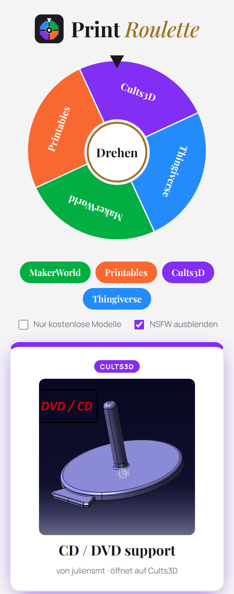

<p align="center"></p>

# Print Roulette

**English** · [Deutsch](README.de.md)

<p align="center">
  
  
  <a href="https://github.com/Schnuecks/print-roulette/pkgs/container/print-roulette"></a>
  
  <a href="LICENSE"></a>
  
</p>

Spin the wheel and discover a random 3D print. Print Roulette picks a model from
**MakerWorld**, **Printables**, **Cults3D** or **Thingiverse** and links straight to its page,
for the evenings when you want to print something but don't know what.

<p align="center">
  
  &nbsp;
  
</p>

## Features

- **Prize wheel** in the platform colours: spin for a random platform, or click a segment or
  button to roll on one platform directly
- **Preview image, title and creator** wherever the platform provides them; every result
  links to the original model page
- **Filters** for free models only and for hiding NSFW content (on by default)
- **History** of the last twelve rolls, stored only in your own browser
- **Keyboard:** the space bar rolls again the same way as last time
- **Six languages:** English, German, French, Spanish, Italian and Dutch; the browser language is
  used by default, the choice is remembered
- **No database, no login, no tracking:** nothing is stored on the server
- **Light and dark mode**, works on phones, respects “reduce motion”
- **Small container:** standard library only, runs as a non-root user with a read-only file
  system and a built-in health check

## Platforms

| Platform | Source | Access | Free filter | NSFW filter |
|---|---|---|---|---|
| MakerWorld | public sitemaps, title and link only | none | – | – |
| Printables | public GraphQL API, random model ID | none | ✓ | ✓ |
| Cults3D | official GraphQL API, random week since 2014 | nickname + API key | ✓ | ✓ |
| Thingiverse | official REST API, random model ID | app token | always free | ✓ |

Platforms without access are greyed out and left off the wheel. MakerWorld's sitemaps carry
no price or NSFW information, so the result card says when a filter cannot apply there.

## Quick start

```yaml
services:
  print-roulette:
    image: ghcr.io/schnuecks/print-roulette:latest
    container_name: print-roulette
    restart: unless-stopped
    read_only: true
    cap_drop: [ALL]
    ports:
      - "8080:8080"
    environment:
      # PUBLIC_URL: https://roulette.example.com   # optional, otherwise taken from the request
      CULTS_USER: your-cults-nickname
      CULTS_API_KEY_FILE: /run/secrets/cults_api_key
      THINGIVERSE_TOKEN_FILE: /run/secrets/thingiverse_token
    secrets:
      - cults_api_key
      - thingiverse_token

secrets:
  cults_api_key:
    file: ./secrets/cults_api_key.txt
  thingiverse_token:
    file: ./secrets/thingiverse_token.txt
```

```bash
docker compose up -d
```

Then open http://localhost:8080. Without Docker: `python app.py` (Python 3.12 or newer, no packages
needed).

### Getting access

- **Cults3D:** create a read-only API key at [cults3d.com/en/api/keys](https://cults3d.com/en/api/keys).
  The username is your Cults nickname.
- **Thingiverse:** create an app at [thingiverse.com/developers](https://www.thingiverse.com/developers)
  (type “Web App”) and use its *App Token*.

**Behind a reverse proxy with custom error pages** (e.g. a Traefik `errors` middleware), leave
`/api/` out of them. The page reads the JSON error responses of the API to show messages in
the chosen language. With Traefik, add a second router for `PathPrefix(`/api/`)` without the
error middleware.

Docker secrets are mounted with the permissions of the file on the host. If the container
cannot read them, run it with your user (`user: "1000:1000"`) or make the files readable.

## Configuration

Every variable holding a credential can also be given as `NAME_FILE`, pointing to a file.

| Variable | Default | Meaning |
|---|---|---|
| `PORT` | `8080` | Port inside the container |
| `PUBLIC_URL` | – (from the request) | Public address for the link preview image. If empty, it is taken from the request (`Host`, behind a proxy `X-Forwarded-Host`/`-Proto`) |
| `CULTS_USER`, `CULTS_API_KEY` | – | Cults3D access |
| `THINGIVERSE_TOKEN` | – | Thingiverse app token |
| `MW_LANG` | `en` | Language of MakerWorld links (`en`, `de`, …) |
| `RATE_PER_MINUTE` | `30` | Rolls per IP and minute |
| `TRUST_PROXY` | `1` | Count clients by `X-Forwarded-For` (behind a reverse proxy); set `0` without a proxy |
| `USER_AGENT` | `PrintRoulette/<version> (+PUBLIC_URL or project URL)` | User agent for requests to the platforms |
| `SOURCE_URL` | `https://github.com/Schnuecks/print-roulette` | Link to the source code in the footer; empty hides it |
| `PRINTABLES_MAX_ID`, `THINGIVERSE_MAX_ID` | built in | Starting point for the highest model ID; the app probes upwards once a day |

## How it stays friendly to the platforms

- MakerWorld: the sitemap index is fetched at most once a day, sitemap pages are cached.
- Cults3D: at most one API call every three minutes, results are kept in a pool, well
  below the daily limit.
- Printables and Thingiverse: one request per roll, plus a short daily probe for new IDs.
- Every request identifies itself with an honest user agent.

## Security

- Links and images reach the browser only if they use HTTPS and point to known hosts of
  the four platforms.
- Strict Content Security Policy without inline code, plus the usual protective headers.
- Rate limit per IP, responses from the platforms are capped at 8 MB, error details stay in
  the log.
- Fonts are served locally; apart from the platforms' preview images the page loads nothing
  from third parties.
- CI checks the code with Ruff (including security rules) and scans the image with Trivy.

What changed in each version is listed in the [CHANGELOG](CHANGELOG.md).

## How it's built

Print Roulette is developed with the help of an AI coding assistant. I define the features and
behaviour, review the changes and test them on my own server. Nothing is released without
passing the automated checks: the test suite and a security scan of the container image.

## Support

Print Roulette is free and stays free. If it found you a nice print, you can buy me a coffee
on Ko-fi; it keeps the project going. Thank you!

<p>
  <a href="https://ko-fi.com/schnuecks"></a>
</p>

## Feedback

Bug reports and ideas are welcome as [GitHub issues](https://github.com/Schnuecks/print-roulette/issues).
Security problems please report privately, see [SECURITY.md](SECURITY.md).

## License

Copyright (C) 2026 Schnuecks

Print Roulette is free software under the
[GNU Affero General Public License, version 3 or later](LICENSE) (AGPL-3.0-or-later). You
may use, modify and share it.

If you distribute a modified version or offer it to others over a network, you must make
the source code of your version available to them under the same license. The “Source
code on GitHub” link in the footer does that for this version; for your own version,
point it to your source code with `SOURCE_URL`.

The program is provided without any warranty. See the [license](LICENSE) for details.
The fonts Playfair Display and Manrope in `static/fonts/` are under the SIL Open Font
License (see the `OFL-*.txt` files there); Print Roulette serves them itself, so the page
loads no fonts from Google or other servers.

Print Roulette is an independent hobby project and not affiliated with MakerWorld,
Printables, Cults3D or Thingiverse. Models and images belong to their platforms and
creators.
